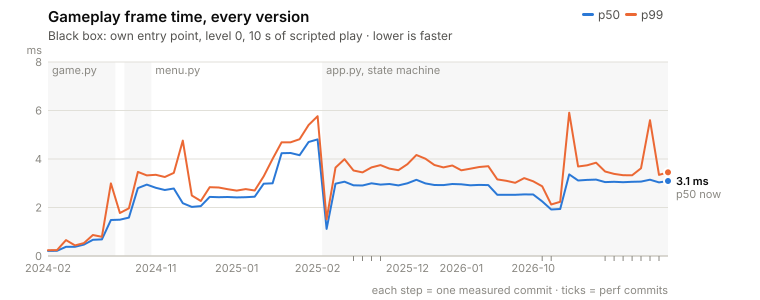
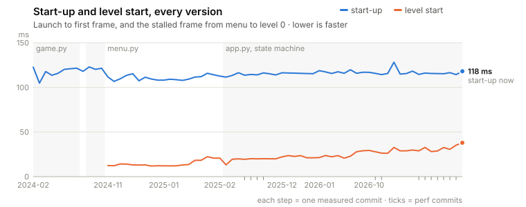
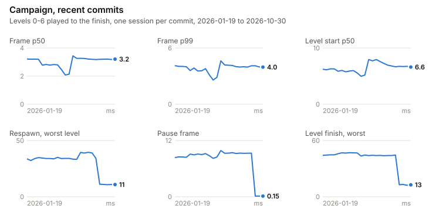
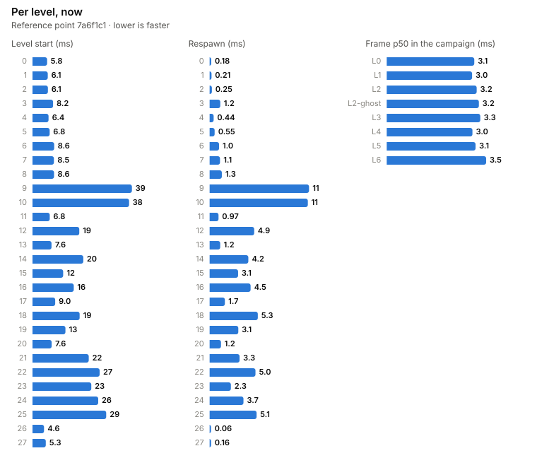

# Benchmarks

<!-- Generated by `python -m tools.bench --save` (tools/bench/report.py); do not edit. -->

Interactive: [`docs/benchmarks/dashboard.html`](docs/benchmarks/dashboard.html) - every chart below with the commit under the pointer, every campaign metric over time and every step between commits, in one file with its data inline. Open it in a browser (GitHub only shows its source).

**Reference point: `7a6f1c1`** (add: level 25 to the benchmark suite), measured 2026-10-30 on Apple M1 · macOS-27.0.1 · Python 3.12.8 · pygame-ce 2.5.6, median of 3 sessions. **Score 992** (reference `89764d0` = 1000, higher is faster).

Compare your working tree against it with `python -m tools.bench` (or `--check` to fail on a regression); record a new reference with `--save`.

| | Now | |
|---|---:|---|
| Frame p50 | **3.21 ms** | 19% of the 16.7 ms a 60 FPS frame may take |
| Frame p99 | **3.96 ms** |  |
| Water frame p50 | **5.48 ms** | level 25, the costliest water level |
| Start-up to menu | **155 ms** |  |
| First level start | **122 ms** | menu -> Play, every asset loaded |
| Level start p50 | **6.62 ms** | next level, levels 1-6 |
| Level start, worst level | **39.48 ms** | slowest of all levels |
| Respawn, worst level | **10.85 ms** | slowest of all levels |
| Pause frame | **0.15 ms** |  |
| F1 perf HUD cost | **0.09 ms** | per frame with F1 on |
| Training env | **12,984 steps/s** | headless, for training |

## Over time

Every version of the game from the first commit (2024-02-07) to `7a6f1c1` (2026-10-30), 70 commits, run as a black box: its own entry point, level 0, 10 s of scripted play, frames back to back (`tools/bench/probe.py`). Each version is measured with the maps, window and features it had, so this is what it cost to run that version - more game made later versions slower as much as code made them faster. The window it drew (headless, so fullscreen versions got the dummy display's size): 640x480 from 2024-02-07, 1228x691 from 2025-01-19, 1024x691 from 2025-01-23, 1024x768 from 2025-02-27, 1280x720 from 2026-07-03.

<picture><source media="(prefers-color-scheme: dark)" srcset="docs/benchmarks/history-frame-dark.svg"></picture>

<picture><source media="(prefers-color-scheme: dark)" srcset="docs/benchmarks/history-loading-dark.svg"></picture>

The campaign (below) runs on every measured commit since `d67c1e9` (2026-01-19), the first whose maps let the recorded runs reach the finish:

<picture><source media="(prefers-color-scheme: dark)" srcset="docs/benchmarks/history-campaign-dark.svg"></picture>

Steps between consecutive measured commits, beyond twice the noise tolerance:

| Commit | Metric | Before → after | Change |
|---|---|---:|---:|
| `68c2a6d` fix: glide the camera instead of stepping whole pixels | Frame p50 | 2.14 ms → 3.44 ms | +61% **worse** |
| `68c2a6d` fix: glide the camera instead of stepping whole pixels | Frame p99 | 2.87 ms → 4.63 ms | +61% **worse** |
| `68c2a6d` fix: glide the camera instead of stepping whole pixels | Level start p50 | 5.19 ms → 7.94 ms | +53% **worse** |
| `68c2a6d` fix: glide the camera instead of stepping whole pixels | First frame render | 2.32 ms → 4.99 ms | +115% **worse** |
| `68c2a6d` fix: glide the camera instead of stepping whole pixels | F1 perf HUD cost | 0.04 ms → 1.17 ms | +2830% **worse** |
| `3fcaedc` perf: respawn without reading the level file again | Respawn, worst level | 34.21 ms → 11.15 ms | -67% better |
| `5df1f1e` perf: save replays with the C json encoder | Level finish, worst | 44.50 ms → 12.84 ms | -71% better |
| `89764d0` perf: compose the pause screen once instead of every frame | First level start | 35.71 ms → 111 ms | +210% **worse** |
| `89764d0` perf: compose the pause screen once instead of every frame | Pause frame | 9.69 ms → 0.15 ms | -98% better |
| `dc03e8f` perf: keep the F1 perf overlay scaled between its rebuilds | F1 perf HUD cost | 1.01 ms → 0.08 ms | -92% better |

## Per level

<picture><source media="(prefers-color-scheme: dark)" srcset="docs/benchmarks/levels-dark.svg"></picture>

## All metrics

**Gameplay (campaign: levels 0-6 played to the finish)**

| Metric | Now | Noise | What it measures |
|---|---:|---:|---|
| Frame p50 ★ | 3.21 ms | ±2% | Typical cost of a gameplay frame (update + render + flip); budget 16.7 ms at 60 FPS |
| Frame p99 ★ | 3.96 ms | ±5% | 1 in 100 gameplay frames is slower than this |
| Frame max | 10.55 ms | ±227% | Slowest gameplay frame (stalls such as respawns included) |
| Update p50 | 0.17 ms | ±6% | Simulation, camera, replay recording |
| Render p50 | 3.03 ms | ±1% | Renderer.render, everything drawn |
| Budget used | 19.3% | ±2% | Frame p50 as a share of the 16.7 ms a 60 FPS frame may take |
| Frames > 16.7 ms | 1 | ±200% | Frames of the whole campaign (stalls included) that would miss a 60 Hz refresh |
| Hitches > 25 ms | 1 | ±100% | As the F1 HUD counts them: a visibly dropped frame |

**Water world (level 25 played to the finish, outside the campaign)**

| Metric | Now | Noise | What it measures |
|---|---:|---:|---|
| Water frame p50 | 5.48 ms | ±1% | Typical cost of a gameplay frame on the water level that costs the most to draw |
| Water frame p99 | 6.09 ms | ±2% | 1 in 100 gameplay frames on level 25 is slower than this |
| Water frames > 16.7 ms | 1 | ±0% | Frames of level 25 (stalls included) that would miss a 60 Hz refresh |

**Loading and stalls (what the player waits for)**

| Metric | Now | Noise | What it measures |
|---|---:|---:|---|
| Start-up to menu ★ | 155 ms | ±15% | Launching the game until the menu is on screen (interpreter start included) |
| First level start ★ | 122 ms | ±37% | Menu -> Play: the frame that builds the first level and loads every asset |
| Level start p50 ★ | 6.62 ms | ±7% | Level-complete -> next level: the stalled frame, levels 1-6 |
| Level start, worst level ★ | 39.48 ms | ±1% | Slowest start of any level (all of them, the 4 MB maps of levels 9 and 10 included) |
| Respawn, worst level ★ | 10.85 ms | ±1% | Dying and coming back: the respawn stall of the slowest level |
| Level finish, worst | 12.74 ms | ±3% | The frame that ends a level: replay and best time saved, level-complete screen built |
| First frame render | 4.41 ms | ±1% | Rendering the first frame of a level (one-time work such as scaling the background) |
| Longest GC pause | 7.28 ms | ±1% | Python's garbage collector stops the game this long at most (campaign) |

**Screens**

| Metric | Now | Noise | What it measures |
|---|---:|---:|---|
| Menu frame ★ | 1.05 ms | ±1% |  |
| Pause frame ★ | 0.15 ms | ±1% |  |
| Opening the pause screen | 12.92 ms | ±2% |  |
| Level-complete frame | 1.11 ms | ±1% |  |

**Features and tools**

| Metric | Now | Noise | What it measures |
|---|---:|---:|---|
| F1 perf HUD cost | 0.09 ms | ±14% | Extra frame time p50 with the HUD on (level 1 played with and without it) |
| Save a replay | 3.01 ms | ±3% | Level 5's best run, ~4900 ticks |
| Load a replay | 3.69 ms | ±0% |  |
| Training env ★ | 12,984 steps/s | ±1% | TrainingEnv.step() per second, headless (snapshot + features included) |

**Caches and memory**

| Metric | Now | Noise | What it measures |
|---|---:|---:|---|
| Text cache hits | 95.0% | ±0% | UI outline-text cache over the campaign |
| Text cache hits, HUD on | 92.3% | ±0% |  |
| Text cache evictions | 5561 | ±2% |  |
| Peak memory | 145.6 MB | ±1% | Most memory the process held from start-up to the end of the campaign |

★ = part of the score. Noise = half the spread between sessions of this run.

Stalls the player waits for, slowest first (where to look next):

| Stall | ms |
|---|---:|
| Start-up to menu | 154.6 |
| First level start of a session | 122.1 |
| Start of level 9 | 39.5 |
| Start of level 10 | 38.4 |
| Start of level 25 | 29.3 |
| Start of level 22 | 26.7 |
| Start of level 24 | 26.1 |
| Start of level 23 | 23.4 |

## How it works

- **Campaign** (`tools/bench/session.py`): start-up, menu, Play, then levels 0-6 one after another through the level-complete screen, each played to the finish by a real best run from `tools/trailer_replays/`; level 2 is replayed once against the ghost of the run just finished, level 3 is paused for 1.5 s. The frame loop is app.py's without the frame pacer, so a frame's time is its cost (update + render + flip), headless at 1280x720. Every frame is labelled (play, level start, level finish, pause, menu ...).
- **Isolated scenarios**: start and respawn of every level, level 1 with and without the F1 HUD, saving and loading a replay, level 25 (the water level that costs the most to draw) played to the finish once per session, skipped by `--quick` and not part of the score, `TrainingEnv` steps per second.
- **Sandbox**: each session runs in a fresh process on links to the working tree, without data/'s player files (best times, coins, replays, settings), so it starts like a fresh install and never changes yours.
- **Sleep**: a machine that sleeps mid-run (on battery, macOS does so after a minute idle) stops perf_counter but not the wall clock; the frames right after each wake run slow and are left out, and a probe run is repeated. The suite keeps the Mac from idle-sleeping (caffeinate), which does not stop maintenance sleep: plug in for long runs.
- **Determinism check**: the outcome of every level (ticks, position, coins, enemies, a hash of the world picture) must match between sessions; a difference against the reference means gameplay changed.
- **History** (`python -m tools.bench history`): older commits in a throwaway clone, measured with the black-box probe and, where the replays still finish, the campaign. Results: `docs/benchmarks/history.json`.
- **Real window**: the benchmark measures CPU cost. Frame pacing and vsync in a real window are `tools/frame_pacing.py`'s job; the F1 HUD shows the same quantities live (Render = its *full* time, Interval, Hitches > 25 ms).

Numbers are only comparable on the same machine. Close other heavy apps while measuring; a full run takes about 4 minutes (`--quick`: 15 s).
