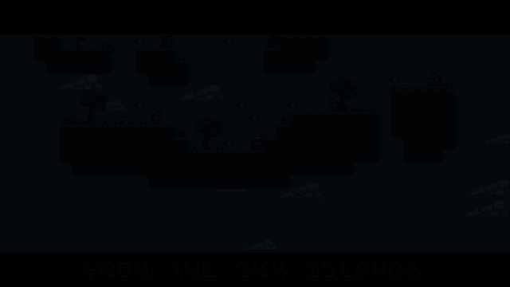
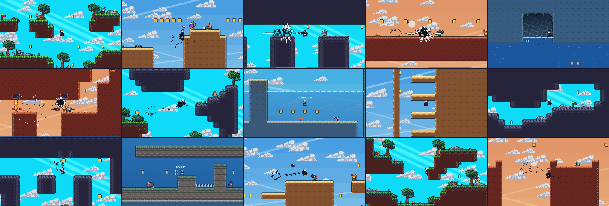

<div align="center">

# Ninja Game

**A fast pixel-art platformer written in pure Python.**<br>
Dash through enemies, race your own ghost, play with friends, build levels, or train an AI agent on it.

[](https://www.python.org/)
[](https://pypi.org/project/pygame-ce/)
[](https://github.com/tombackert/ninja-game/actions)
[](https://opensource.org/licenses/MIT)



[Quick start](#quick-start) · [Controls](#controls) · [Train an AI agent](#train-an-ai-agent)

</div>

## Quick start

```bash
git clone https://github.com/tombackert/ninja-game.git
cd ninja-game
pip install -e .
ninja-game
```

That's it: Python 3.10+ is the only requirement (pygame-ce is installed automatically).

## Features

- **Tight platforming**: double jump, wall-slide and wall-jump, and a dash that kills enemies on contact
- **Checkpoints**: a banner halfway through a level; touch it and a fall sends you back there, not to the start
- **Ghost replays**: every run is recorded, so you can race a ghost of your best (or last) run
- **Multiplayer**: host from the menu and friends join by IP, with server-authoritative UDP netcode, client-side prediction and interpolation ([details](docs/multiplayer.md))
- **Store & accessories**: spend coins on 5 weapons (gun, rifle, ninja stars, sword, grapple hook), 4 gear items (shield, moon boots, coin magnet, lucky charm) and 6 skins
- **40 levels** across sky, cave, desert, Mars and water worlds, with best times per level, plus a **level editor** to build your own
- **Water world**: swim with strokes, ride currents and geysers, dodge drains and come up for air before your breath runs out (levels 21-25 and 36-40)
- **Deterministic simulation**: a seeded RNG and a single `step()` drive live play, replays, netcode prediction and training alike
- **Gym-style RL environment**: `reset()` / `step()`, feature observations and shaped rewards, headless
- **Performance HUD** (F1): frame times, hitches and entity counts in real time



## Controls

| Action | Single player | Multiplayer |
|--------|---------------|-------------|
| Move | A / D or ← / → | A / D or ← / → |
| Jump (press again in the air for a double jump; against a wall for a wall-jump; under water a swim stroke) | W / ↑ | W / ↑ |
| Dash | Space / right mouse button | Space / X |
| Shoot (needs a weapon from the store) | X / left mouse button | C |
| Restart from checkpoint (costs a life) | R | |
| Set checkpoint (once per level) | P | |
| Pause | Esc | Esc |
| Performance HUD | F1 | F1 |

## Play with friends

One player hosts, the others join:

1. Host: **Menu → Multiplayer → Host Game**. The HUD shows the address to share, e.g. `Hosting on 192.168.178.92:7777`.
2. Friends: **Menu → Multiplayer → Join Game**, enter that address and press Enter.

Or from the command line:

```bash
ninja-server --port 7777 --level 0                     # dedicated server
ninja-game --multiplayer --host <ip> --port 7777 --name Tom
```

Rules, firewall notes and the netcode architecture are described in [docs/multiplayer.md](docs/multiplayer.md).

## Train an AI agent

`TrainingEnv` wraps the same simulation the game runs in a gym-style interface. It is deterministic for a given seed and needs no window:

```python
# SDL_VIDEODRIVER=dummy python train.py
from scripts.training_env import TrainingEnv

env = TrainingEnv(seed=42, level_id=0)
obs = env.reset()
done = False
while not done:
    action = 2  # 0 no-op, 1 left, 2 right, 3 jump, 4 left+jump, 5 right+jump, 6 dash, 7 shoot
    obs, reward, done, info = env.step(action)
print(info["level_cleared"], info["lives"], info["coins"])
```

An adapter for RLlib-style training loops is in [examples/train_integration.py](examples/train_integration.py).

### A learned playtester for the fights

The level tools plan every level's route without enemies. `tools/rl` plays one stretch of that route with the enemies, shots and flame jets live, under human limits: a decision every 4 frames, 200 ms reaction delay, no gear or weapon, no dash wall climb. It measures how often a player gets through. A stretch runs from one fixed point of the route to the next, each a waypoint the player stands on; through a maze of mid-air waypoints it plays on to the exit. The evaluation checks that the planner takes over from wherever the agent arrived.

The agent has three parts:

- **Guide** (`tools/rl/guide.py`). Before training, the planner plans once per stretch from many states around the route:
  - states a few random moves off the route
  - by a flame jet, the beats in which the route would burn
  - three rounds of the states the agent met but the guide did not know yet, or where it made no progress along the route for a second (the guide's answers there went round in a loop)
  - two rounds of the states where the way after an attack on an enemy got lost

  Plans from those missed states end where they reach the route again. Built once per stretch and cached in `tools/rl/cache/`.
- **Route action.** One action follows the route, off it the guide, and by a flame the guide's way for the jet's beat. It looks 20 frames ahead along that way (32 near a jumper) at the enemies as the player saw them 200 ms ago: a patrol walks on by its rules, a jumper hops by its own, a shot flies on, and a gunner whose walk ends or a turret whose cooldown runs out fires the shot a player expects. If the way runs into one of them or into a burning jet, it waits, dashes through, jumps or backs off.
  - **Kills.** As a player would, it kills an enemy on the way on that is a danger: one that hurts on touch and that the way meets, or an armed one that has the player in sight. It dashes at it or jumps onto it, but only if the attack kills it, the way after it runs into nothing for 72 frames, and the guide leads back to the route from there. Enemies behind are left: going back costs the dash the way on needs. No reward is paid for a kill.
- **Policy** (PPO, `tools/rl/ppo.py`). It sees the last 4 decisions and chooses between the route action and the 12 moves, so it learns when to leave the way. Half the episodes start at a later waypoint, mostly where the agent fails most.

Level 11, 200 evaluation episodes each (8 cores):

| Stretch | Policy | Route action alone | Route played blind | Guide build | Training |
|---|---|---|---|---|---|
| Segments 9-11 (gunners, turrets, a jumper) | 95%, 2.6 kills | 97%, 3.3 kills | 0% | 4 min | 6 min |
| Maze, segments 22-31 (gunners, turrets, patrols, chasers, flame jets) | 94%, 1.5 kills | 92%, 1.4 kills | 0% | 8 min | 10 min |

Kills are per episode. On segments 9-11 the kills halve the route action's last-moment dodges (5.1 to 2.1 per episode, 300 episodes) and bring it to the goal 80 frames sooner, at the same goal rate.

It needs `numpy` and `torch`:

```bash
python -m tools.rl threats 11              # enemies near each segment of the route
python -m tools.rl train 11 9 --span 3     # guide (once, cached), then PPO on segments 9-11
python -m tools.rl eval 11 9 --span 3      # goal / death / timeout rate and planner handoff: policy, route action alone, route played blind
python -m tools.rl eval 11 22 --per-start 50  # ... and the goal rate from every waypoint on: where a long stretch fails
python -m tools.rl.watch 11 9 --span 3     # watch it in a game window (--video out.mp4 to record)
```

## Level editor

```bash
ninja-editor        # or: python editor.py
```

| Action | Input |
|--------|-------|
| Place / erase tile | Left / right mouse button |
| Choose tile type / variant | Mouse wheel / Shift + mouse wheel |
| Scroll | W A S D or arrow keys |
| Toggle grid snapping | G |
| Auto-tile edges | T |
| Multi-tile brush (Space + wheel sets the size) | M |
| Water: pick the `water` group, Shift + wheel picks still water or a current (→ ← ↑ ↓) | Mouse wheel |
| Save / save and quit | O / Esc |

## Installation details

`pip install -e .` installs three console commands:

| Command | Description |
|---------|-------------|
| `ninja-game` | Launch the game (accepts `--multiplayer`, `--host`, `--port`, `--name`) |
| `ninja-editor` | Launch the level editor |
| `ninja-server` | Launch the dedicated multiplayer server |

> Use an **editable** install (`pip install -e .`). Assets are loaded relative
> to the cloned repo, so the source tree must stay in place. The commands
> switch into it automatically before starting.

To also install the development tools (pytest, black, ruff, mypy, pre-commit):

```bash
pip install -e ".[dev]"
```

Alternatively, run directly without installing:

```bash
pip install pygame-ce
python app.py
```

## Architecture

The codebase follows a state-driven architecture with clear separation of concerns:

```
├── app.py              # Main entry point (StateManager-based)
├── game.py             # World state and the single simulation step()
├── editor.py           # Level editor
├── server.py           # Dedicated multiplayer server
├── scripts/            # Core game logic
│   ├── entities.py     # Player, Enemy, PhysicsEntity
│   ├── state_manager.py
│   ├── input_router.py # Event → Action mapping
│   ├── renderer.py     # Unified rendering pipeline
│   ├── training_env.py # Gym-style RL environment
│   ├── ai/             # Pluggable AI behaviors
│   ├── network/        # Multiplayer server, client and headless simulation
│   └── weapons/        # Extensible weapon system
├── data/               # Assets, maps, settings
├── tools/              # Benchmarks, E2E bots, trailer renderer
└── tests/              # Pytest suite
```

For detailed architecture documentation, see [docs/architecture.md](docs/architecture.md).

## Development

### Running tests

Tests run headless using the SDL dummy driver:

```bash
export SDL_VIDEODRIVER=dummy
pytest -q
```

### Pre-commit hooks

This repository uses pre-commit hooks for code quality (Ruff, Black, mypy):

```bash
pip install pre-commit
pre-commit install
```

Run all hooks manually:

```bash
pre-commit run --all-files
```

### Benchmarks

A headless benchmark plays levels 0-6 the way a player does (start-up, menu, every level to the finish, a pause, a ghost race) and times every frame, load and stall. Current reference numbers and their history back to the first commit: **[BENCHMARKS.md](BENCHMARKS.md)**.

```bash
python -m tools.bench            # compare your working tree with the reference (~4 min)
python -m tools.bench --quick    # one short session (~15 s)
python -m tools.bench --check    # exit 1 on a regression beyond noise
python -m tools.bench --save     # record this run as the new baseline (BENCHMARKS.md)
```

### Building the worlds

Levels 11 and up are built from code in `tools/worlds/levels/` and proven playable start to flag with the game's exact physics:

```bash
python -m tools.worlds.build 14 --preview out/   # write the map, plan its route, render an overview
python -m tools.worlds.build 14 --assess         # ... and measure it right away: hard sections, time to clear
python -m tools.worlds.stills 14 --out out/      # stills of the real game along the route: how it looks to a player
python -m tools.worlds.play 14 --video           # play it in the real game window: menu, keyboard, live enemies
python -m tools.worlds.assess 9 14 --resample    # compare its difficulty with level 9
python -m tools.worlds.assess 14 --windows       # timing window per element, minutes and deaths to the first clear
python -m tools.worlds.assess 14 --sections --playtime  # the previous metric: which sections make it hard, where players die
python -m tools.worlds.check_physics --maps 21 22 --route  # the physics replica against the real game
python tools/gen_world_tiles.py                  # redraw the sand and mars tiles, decor and skies
python tools/gen_water_world.py                  # redraw the water world: tiles, water, decor, swim cycle, skies
```

### Rendering the trailer

The trailer and the level matrix above are rendered from real runs (best runs, the route bot's runs for the desert and Mars worlds, the route plans for the water world), re-simulated headless by the game itself:

```bash
python tools/trailer.py            # docs/media/trailer.mp4, trailer.gif, social-preview.png, levels.png (needs ffmpeg)
python tools/trailer.py --sheet    # quick contact sheet of all shots
python tools/trailer.py --levels   # only levels.png
```

### Project structure

| Directory | Purpose |
|-----------|---------|
| `scripts/` | Core game logic |
| `scripts/ai/` | AI policy implementations |
| `scripts/network/` | Multiplayer infrastructure |
| `scripts/weapons/` | Weapon system |
| `data/` | Assets, maps, saves, settings |
| `tests/` | Pytest test suite |
| `tools/` | Benchmarks, E2E bots, frame pacing, trailer |
| `docs/` | Architecture, multiplayer and patch notes |
| `experiments/` | Benchmarks and prototypes |

## Contributing

Contributions are welcome. Here are some ways to help:

- **Create levels**: use the level editor to design new challenges
- **Report bugs**: open an issue with reproduction steps
- **Add features**: check the [backlog](docs/backlog.md) for ideas
- **Improve documentation**: help others understand the codebase
- **Add AI behaviors**: extend the policy system with new enemy types

If you enjoy the game, a ⭐ helps others find it.

## Credits

Based on the tutorial by [DaFluffyPotato](https://www.youtube.com/@DaFluffyPotato): [Pygame Platformer Tutorial](https://www.youtube.com/watch?v=2gABYM5M0ww)

Built with [pygame-ce](https://github.com/pygame-community/pygame-ce) ([docs](https://pyga.me/docs/)).

## Citation

If you use this project in your research or work, please cite it as:

```bibtex
@software{backert2025ninjagame,
  author       = {Backert, Tom},
  title        = {Ninja Game: A Deterministic 2D Platformer with Modular AI},
  year         = {2025},
  url          = {https://github.com/tombackert/ninja-game},
  version      = {3.0}
}
```

## License

This project is licensed under the MIT License. See [LICENSE](LICENSE) for details.
