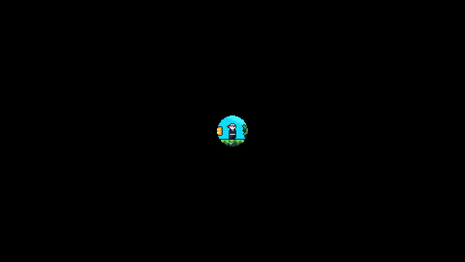
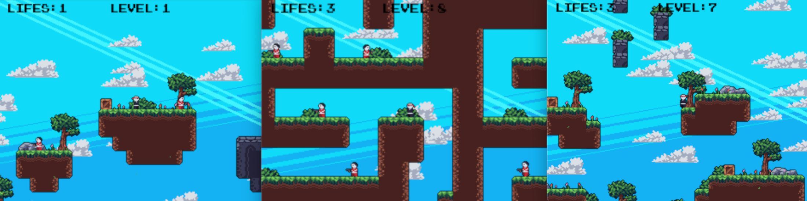

<div align="center">

# Ninja Game

**A fast pixel-art platformer written in pure Python.**<br>
Dash through enemies, race your own ghost, play with friends, build levels, or train an AI agent on it.

[](https://www.python.org/)
[](https://pypi.org/project/pygame-ce/)
[](https://github.com/tombackert/ninja-game/actions)
[](https://opensource.org/licenses/MIT)



[Quick start](#quick-start) · [Controls](#controls) · [Train an AI agent](#train-an-ai-agent)

</div>

## Quick start

```bash
git clone https://github.com/tombackert/ninja-game.git
cd ninja-game
pip install -e .
ninja-game
```

That's it: Python 3.10+ is the only requirement (pygame-ce is installed automatically).

## Features

- **Tight platforming**: double jump, wall-slide and wall-jump, and a dash that kills enemies on contact
- **Ghost replays**: every run is recorded, so you can race a ghost of your best (or last) run
- **Multiplayer**: host from the menu and friends join by IP, with server-authoritative UDP netcode, client-side prediction and interpolation ([details](docs/multiplayer.md))
- **Store & accessories**: spend coins on 5 weapons (gun, rifle, ninja stars, sword, grapple hook), 4 gear items (shield, moon boots, coin magnet, lucky charm) and 6 skins
- **12 hand-built levels** with best times per level, plus a **level editor** to build your own
- **Deterministic simulation**: a seeded RNG and a single `step()` drive live play, replays, netcode prediction and training alike
- **Gym-style RL environment**: `reset()` / `step()`, feature observations and shaped rewards, headless
- **Performance HUD** (F1): frame times, hitches and entity counts in real time



## Controls

| Action | Single player | Multiplayer |
|--------|---------------|-------------|
| Move | A / D or ← / → | A / D or ← / → |
| Jump (press again in the air for a double jump; against a wall for a wall-jump) | W / ↑ | W / ↑ |
| Dash | Space / right mouse button | Space / X |
| Shoot (needs a weapon from the store) | X / left mouse button | C |
| Restart from checkpoint (costs a life) | R | |
| Set checkpoint (once per level) | P | |
| Pause | Esc | Esc |
| Performance HUD | F1 | F1 |

## Play with friends

One player hosts, the others join:

1. Host: **Menu → Multiplayer → Host Game**. The HUD shows the address to share, e.g. `Hosting on 192.168.178.92:7777`.
2. Friends: **Menu → Multiplayer → Join Game**, enter that address and press Enter.

Or from the command line:

```bash
ninja-server --port 7777 --level 0                     # dedicated server
ninja-game --multiplayer --host <ip> --port 7777 --name Tom
```

Rules, firewall notes and the netcode architecture are described in [docs/multiplayer.md](docs/multiplayer.md).

## Train an AI agent

`TrainingEnv` wraps the same simulation the game runs in a gym-style interface. It is deterministic for a given seed and needs no window:

```python
# SDL_VIDEODRIVER=dummy python train.py
from scripts.training_env import TrainingEnv

env = TrainingEnv(seed=42, level_id=0)
obs = env.reset()
done = False
while not done:
    action = 2  # 0 no-op, 1 left, 2 right, 3 jump, 4 left+jump, 5 right+jump, 6 dash, 7 shoot
    obs, reward, done, info = env.step(action)
print(info["level_cleared"], info["lives"], info["coins"])
```

An adapter for RLlib-style training loops is in [examples/train_integration.py](examples/train_integration.py).

## Level editor

```bash
ninja-editor        # or: python editor.py
```

| Action | Input |
|--------|-------|
| Place / erase tile | Left / right mouse button |
| Choose tile type / variant | Mouse wheel / Shift + mouse wheel |
| Scroll | W A S D or arrow keys |
| Toggle grid snapping | G |
| Auto-tile edges | T |
| Multi-tile brush (Space + wheel sets the size) | M |
| Save / save and quit | O / Esc |

## Installation details

`pip install -e .` installs three console commands:

| Command | Description |
|---------|-------------|
| `ninja-game` | Launch the game (accepts `--multiplayer`, `--host`, `--port`, `--name`) |
| `ninja-editor` | Launch the level editor |
| `ninja-server` | Launch the dedicated multiplayer server |

> Use an **editable** install (`pip install -e .`). Assets are loaded relative
> to the cloned repo, so the source tree must stay in place. The commands
> switch into it automatically before starting.

To also install the development tools (pytest, black, ruff, mypy, pre-commit):

```bash
pip install -e ".[dev]"
```

Alternatively, run directly without installing:

```bash
pip install pygame-ce
python app.py
```

## Architecture

The codebase follows a state-driven architecture with clear separation of concerns:

```
├── app.py              # Main entry point (StateManager-based)
├── game.py             # World state and the single simulation step()
├── editor.py           # Level editor
├── server.py           # Dedicated multiplayer server
├── scripts/            # Core game logic
│   ├── entities.py     # Player, Enemy, PhysicsEntity
│   ├── state_manager.py
│   ├── input_router.py # Event → Action mapping
│   ├── renderer.py     # Unified rendering pipeline
│   ├── training_env.py # Gym-style RL environment
│   ├── ai/             # Pluggable AI behaviors
│   ├── network/        # Multiplayer server, client and headless simulation
│   └── weapons/        # Extensible weapon system
├── data/               # Assets, maps, settings
├── tools/              # Benchmarks, E2E bots, trailer renderer
└── tests/              # Pytest suite
```

For detailed architecture documentation, see [docs/architecture.md](docs/architecture.md).

## Development

### Running tests

Tests run headless using the SDL dummy driver:

```bash
export SDL_VIDEODRIVER=dummy
pytest -q
```

### Pre-commit hooks

This repository uses pre-commit hooks for code quality (Ruff, Black, mypy):

```bash
pip install pre-commit
pre-commit install
```

Run all hooks manually:

```bash
pre-commit run --all-files
```

### Benchmarks

A headless benchmark plays levels 0-6 the way a player does (start-up, menu, every level to the finish, a pause, a ghost race) and times every frame, load and stall. Current reference numbers and their history back to the first commit: **[BENCHMARKS.md](BENCHMARKS.md)**.

```bash
python -m tools.bench            # compare your working tree with the reference (~4 min)
python -m tools.bench --quick    # one short session (~15 s)
python -m tools.bench --check    # exit 1 on a regression beyond noise
python -m tools.bench --save     # record this run as the new baseline (BENCHMARKS.md)
```

### Rendering the trailer

The trailer above is rendered from real best runs, re-simulated headless by the game itself:

```bash
python tools/trailer.py            # docs/media/trailer.mp4, trailer.gif, social-preview.png (needs ffmpeg)
python tools/trailer.py --sheet    # quick contact sheet of all shots
```

### Project structure

| Directory | Purpose |
|-----------|---------|
| `scripts/` | Core game logic |
| `scripts/ai/` | AI policy implementations |
| `scripts/network/` | Multiplayer infrastructure |
| `scripts/weapons/` | Weapon system |
| `data/` | Assets, maps, saves, settings |
| `tests/` | Pytest test suite |
| `tools/` | Benchmarks, E2E bots, frame pacing, trailer |
| `docs/` | Architecture, multiplayer and patch notes |
| `experiments/` | Benchmarks and prototypes |

## Contributing

Contributions are welcome. Here are some ways to help:

- **Create levels**: use the level editor to design new challenges
- **Report bugs**: open an issue with reproduction steps
- **Add features**: check the [backlog](docs/backlog.md) for ideas
- **Improve documentation**: help others understand the codebase
- **Add AI behaviors**: extend the policy system with new enemy types

If you enjoy the game, a ⭐ helps others find it.

## Credits

Based on the tutorial by [DaFluffyPotato](https://www.youtube.com/@DaFluffyPotato): [Pygame Platformer Tutorial](https://www.youtube.com/watch?v=2gABYM5M0ww)

Built with [pygame-ce](https://github.com/pygame-community/pygame-ce) ([docs](https://pyga.me/docs/)).

## Citation

If you use this project in your research or work, please cite it as:

```bibtex
@software{backert2025ninjagame,
  author       = {Backert, Tom},
  title        = {Ninja Game: A Deterministic 2D Platformer with Modular AI},
  year         = {2025},
  url          = {https://github.com/tombackert/ninja-game},
  version      = {3.0}
}
```

## License

This project is licensed under the MIT License. See [LICENSE](LICENSE) for details.
